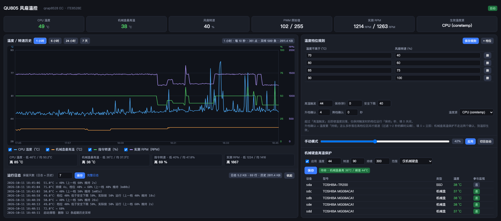

# QU805 风扇调速（威联通 QU805 + 飞牛 fnOS）

让 **威联通 QU805**（iEi **SA145** 主板 / **ITE8528E** EC 芯片）在刷了 **飞牛 fnOS**
之后重新拿回风扇 PWM 控制权，并用一个 Web UI 做温度自适应调速。

顺带解决了三件让人头疼的事：

| 痛点 | 本项目的做法 |
|---|---|
| `modprobe qnap8528` 报 `No such device` | 给驱动补一条 `QU805 / SA145` 机型配置（子串匹配 `MB=` 串） |
| **系统更新后风扇又失控** | 内核安装钩子 + 开机自愈脚本，**下次升级不用再人工修** |
| 只能命令行写 pwm | Web UI：温度档位表（带换档防抖）、手动模式、机械盘高温保护、持久化日志、历史曲线 |

同主板的 **QU605 / QU805** 系列应该都适用（未验证，欢迎反馈）。

**两种安装方式，效果一样：**

- **手工安装**（本 README 的主体）：`sudo bash install.sh`，Web UI 跑在 Docker 容器里（端口 8080）；
- **飞牛应用（FPK）**：打成 `.fpk` 在「应用中心 → 手动安装」里装，Web UI 由飞牛
  systemd 直接拉起 `python3`（端口 8605），不用 Docker，也不需要自己管钩子 ——
  见 [第 14 节](#14-打包成飞牛应用离线安装) 与 [`fpk/`](fpk/)。

> **English TL;DR** — Restore PWM fan control on a QNAP QU805 (iEi SA145 / ITE8528E EC)
> running fnOS, then run a small web UI for temperature‑based fan curves, per‑disk
> temperature protection, and persistent logs. Includes a kernel postinst hook so a
> kernel upgrade no longer silently breaks the fan driver. Ships both a manual
> `install.sh` route and a self‑contained fnOS `.fpk` app package under `fpk/`.



*1920×1080 一屏装得下，不用滚动。界面按「看数据 / 做设置」分成左右两张卡片：
左侧是温度 / 转速历史曲线与运行日志，右侧是温度档位规则、手动模式与机械硬盘高温保护。*

---

## 目录

- [1. 问题现象](#1-问题现象)
- [2. 原理](#2-原理)
- [3. 环境要求](#3-环境要求)
- [4. 快速开始](#4-快速开始)
- [5. 分步说明](#5-分步说明)
- [6. Web UI](#6-web-ui)
- [7. 温控规则](#7-温控规则)
- [8. 系统更新后自动恢复（防复发）](#8-系统更新后自动恢复防复发)
- [9. 运行日志](#9-运行日志)
- [10. 历史曲线](#10-历史曲线)
- [11. 故障排查](#11-故障排查)
- [12. 回滚](#12-回滚)
- [13. 常见问题](#13-常见问题)
- [14. 打包成飞牛应用（离线安装）](#14-打包成飞牛应用离线安装)
- [15. 目录结构](#15-目录结构)
- [16. 许可与致谢](#16-许可与致谢)

---

## 1. 问题现象

QU805 原厂是 QuTS/QTS 系统，风扇由 EC 芯片管理。刷成飞牛 fnOS 后，常见两种症状：

- 风扇**一直全速**转，或者干脆不转；
- `/sys/class/hwmon` 下**找不到任何 `pwm*` 接口**，`sensors` 也看不到风扇转速。

手动加载驱动会失败：

```console
# modprobe qnap8528
modprobe: FATAL: Module qnap8528 not found in directory /lib/modules/<内核版本>
```

如果模块已编译但加载失败，`dmesg` 里是这样：

```text
qnap8528 @ qnap8528_ec_hw_check: Could not locate IT8528 EC device
qnap8528 @ qnap8528_find_config: Searching configs for a match with MB=<主板串>
qnap8528 @ qnap8528_find_config: Could not find configuration for device
qnap8528: probe with driver qnap8528 failed with error -524
```

---

## 2. 原理

### 2.1 为什么风扇会失控

飞牛 fnOS 自带 `qnap8528` 驱动源码（`/usr/src/qnap8528-<版本>/`），但**没有为新内核编译过**，
而且驱动内部的机型表里**没有 QU805**。两层原因叠在一起，就成了「风扇不可控」。

### 2.2 为什么 `modprobe` 一定失败

驱动里维护一张「主板型号 → 风扇 / 槽位 / LED 能力」的表，只认登记过的机型。
匹配逻辑（`src/qnap8528.c`）是**子串匹配**：

```c
if (strstr(mb_model, qnap8528_configs[i].mb_model))
```

本机 `MB=` 串形如 `70006SA14500xxxxRS`，所以只要给表里补一条
`mb_model = "SA145"` 的记录就能命中 —— 这就是 [`scripts/patch_qnap_config.py`](scripts/patch_qnap_config.py)
做的事。

另外 EC 的硬件 ID 校验在本机过不了，加载时必须带 `skip_hw_check=true`（跳过校验不影响功能）。

> `it87` 模块在这台机器上同样 `No such device`，它不是正解，别在它上面浪费时间。

### 2.3 架构

```text
┌─────────────────────────────────────────────────────────────────────┐
│  fnOS                                                                 │
│                                                                       │
│  ┌──────────────────┐   /sys/class/hwmon/hwmonX/pwm1   ┌───────────┐  │
│  │ qnap8528 (DKMS)  │◄─────────────────────────────────│ 风扇 1 / 2│  │
│  │ ITE8528E EC      │        写 0-255 即调速           │  (EC)     │  │
│  └──────────────────┘                                  └───────────┘  │
│           ▲                                                           │
│           │ 补机型配置 + dkms install + modprobe skip_hw_check=true    │
│           │                                                           │
│  ┌────────┴─────────┐                                                 │
│  │ 防复发（自动）    │  /etc/kernel/postinst.d/zz-qnap8528  ← 升级时    │
│  │                  │  /usr/local/sbin/qnap8528-load.sh    ← 开机时    │
│  └──────────────────┘                                                 │
│                                                                       │
│  ┌────────────────────────────────────────────────────────┐           │
│  │ Docker: fnos-fan-webui   (--privileged)                │           │
│  │   /sys/class/hwmon :rw  →  读温度 / 写 pwm1             │           │
│  │   /sys/class/thermal:ro                                │           │
│  │   /vol1/docker/.../data → curve-config.json + fan.log  │           │
│  │   :8080 → Web UI + JSON API                            │           │
│  └────────────────────────────────────────────────────────┘           │
│                                                                       │
│  drivetemp (内核模块) → 每块 SATA 盘的 SMART 温度，暴露成 hwmon          │
└─────────────────────────────────────────────────────────────────────┘
```

要点：

- 风扇温度的**执行端**是 `qnap8528` 驱动暴露的 `hwmon` 节点，写 `pwm1` 即可调速；
- 磁盘温度不需要 `smartmontools` —— 内核 `drivetemp` 模块会把每块 SATA 盘的
  SMART 温度直接暴露成 `hwmon`（`name=drivetemp`）；
- 容器靠**软链文本的末段**（都是 SCSI 地址，如 `2:0:0:0`）把 `hwmon` 配对回
  `/dev/sdX`，再读 `queue/rotational` 区分机械盘和 SSD，因此**不需要额外挂载**。

---

## 3. 环境要求

| 项目 | 要求 |
|---|---|
| 机型 | 威联通 QU805（或同主板 QU605），主板 iEi **SA145**，EC **ITE8528E** |
| 系统 | 飞牛 fnOS（其他 Debian 系应该也行，未验证） |
| 必备 | `dkms`、`gcc`、`make`、`python3`、当前内核的 `linux-headers-<版本>` |
| 可选 | `docker`（部署 Web UI 时需要）、`dmidecode`（自检用） |
| 源码 | `/usr/src/qnap8528-<版本>/`（fnOS 自带） |

> **检查内核头文件**：`ls /lib/modules/$(uname -r)/build` 必须存在，
> 否则无法编译 DKMS 模块。缺的话先 `apt install linux-headers-$(uname -r)`。

---

## 4. 快速开始

```bash
# 1) 把仓库放到 NAS 上（或直接 scp 上去）
git clone https://github.com/wymam/qnap-qu805-fan-control.git
cd qnap-qu805-fan-control

# 2) 看一眼环境，不落盘
sudo bash install.sh --dry-run

# 3) 全量安装（驱动 + 持久化 + 防复发 + Web UI），全程不用重启
sudo bash install.sh
```

装完打开 `http://<NAS_IP>:8080` 即可。

只想修驱动、不要 Web UI：

```bash
sudo bash install.sh --skip-app
```

---

## 5. 分步说明

不想用一键脚本的话，这是它内部做的事。

### 5.1 硬件体检

```bash
uname -r
dmidecode -s baseboard-product-name      # 应输出 SA145
dmidecode -s system-product-name         # 应输出 QuNAS-X05
for d in /sys/class/hwmon/hwmon*; do echo "$d : $(cat $d/name)"; done
ls -1 /sys/class/hwmon/*/pwm*            # 修复前无输出；修好后 = hwmon3/pwm1
sensors
```

> ⚠️ **不要用 `find /sys/class/hwmon -name "pwm*"` 判断有没有 PWM**：
> `hwmon*` 是符号链接，`find` 默认不跟随，**即使 `pwm1` 存在也永远返回 0**。
> 用 `ls -1 /sys/class/hwmon/*/pwm*`。

### 5.2 补机型配置

```bash
python3 scripts/patch_qnap_config.py --dry-run     # 先看要插什么
sudo python3 scripts/patch_qnap_config.py
```

脚本会在配置表末尾的 `{ NULL }` 终止符**之前**插入一个括号配平的配置块，
并自动备份成 `qnap8528.h.bak-qu805`。幂等，重复跑不会重复插入。

参数可调：`--model`（标识名）、`--board`（主板子串，必须能命中 `MB=` 串）、
`--fans`（风扇 EC 索引，默认 `1,2`）。

### 5.3 编译并加载

```bash
K=$(uname -r)
sudo dkms install qnap8528/<版本> -k $K
sudo modprobe qnap8528 skip_hw_check=true
lsmod | grep qnap8528
dmesg | tail -6
```

成功的标志：

```text
qnap8528 @ qnap8528_find_config: Model MB code match found
qnap8528 @ qnap8528_find_config: Device model is QU805
qnap8528 @ qnap8528_register_hwmon: Hwmon device registered
```

编译时若出现 <code>cp: cannot stat '/lib/modules/&lt;K&gt;/build/.config'</code>，
**可以忽略** —— 只是 DKMS 想拷内核 `.config` 而已，模块照常编译、签名、加载。

### 5.4 验证 PWM 真的能控速

```bash
H=$(dirname $(ls /sys/class/hwmon/*/pwm1 | head -1))
ORIG=$(cat $H/pwm1)
echo 180 > $H/pwm1; sleep 6; cat $H/fan1_input   # 转速应明显上升
echo 230 > $H/pwm1; sleep 6; cat $H/fan1_input
echo $ORIG > $H/pwm1                              # 务必恢复原值
```

> 只往**提速**方向测，降速/停转有风险。
> 容器在自动模式下每个控制周期（默认 2 秒）会按曲线覆写 `pwm1`，想干净地测就先
> `docker stop fnos-fan-webui`，测完再 `start`。

### 5.5 持久化

```bash
# 开机自动加载（注意：先写普通文件再 sudo cp，别用 tee -a 管道——
# sudo 时间戳没过期时它不读 stdin，会把密码吃进目标文件）
printf 'qnap8528\n'                            > /tmp/ml.conf
printf 'options qnap8528 skip_hw_check=true\n' > /tmp/mp.conf
sudo cp /tmp/ml.conf /etc/modules-load.d/qnap8528.conf
sudo cp /tmp/mp.conf /etc/modprobe.d/qnap8528.conf

# 磁盘温度传感器
printf 'drivetemp\n' > /tmp/dt.conf
sudo cp /tmp/dt.conf /etc/modules-load.d/drivetemp.conf
sudo modprobe drivetemp      # 立即生效，不用重启
```

### 5.6 部署 Web UI

```bash
sudo mkdir -p /vol1/docker/fnos-fan-webui/data
sudo cp app/fan_webui.py app/Dockerfile /vol1/docker/fnos-fan-webui/
sudo docker build -t fnos-fan-webui:latest /vol1/docker/fnos-fan-webui

sudo docker rm -f fnos-fan-webui 2>/dev/null
sudo docker run -d --name fnos-fan-webui --restart=unless-stopped \
  --privileged \
  -v /sys/class/hwmon:/sys/class/hwmon:rw \
  -v /sys/class/thermal:/sys/class/thermal:ro \
  -v /vol1/docker/fnos-fan-webui/data:/data \
  -p 8080:8080 \
  fnos-fan-webui:latest
```

两个挂载是**硬要求**：

- `--privileged`：否则 `pwm1` 写入静默失败，界面看着正常但风扇纹丝不动；
- `/sys/class/hwmon` 必须 `:rw`（不是 `:ro`）。

> 驱动是**在容器运行期间**才恢复的话，记得 `docker restart fnos-fan-webui`：
> 自动模式的控制循环会缓存首次探测到的 pwm 路径。

---

## 6. Web UI

### 6.1 功能

- 实时显示 **温度 / 机械盘最高温 / 转速百分比 / PWM 原始值 / 实测 RPM**
- 温度档位表可**增删改**，保存即生效
- **升档 / 降档持续确认**：温度要「持续」若干秒落在目标档位区间才真正换档，
  用来过滤编译、突发负载带来的 1~2 秒瞬时尖峰（各档可单独设，填 0 = 立即）
- **高温滞后保持**：超过阈值后维持触发时的档位一段时间，避免转速抖动
- **机械硬盘高温保护**：任一机械盘达到阈值 → 转速提到指定值并保持一段时间；
  **到温立即生效**，不经过上面的持续确认
- **手动模式**：拖滑块 → 点「应用」一步写入硬件并切到手动，无中间态
- **转速硬性下限 42%**：程序内置一条**不可突破**的下限（机械硬盘低速运转散热不足，
  长期会缩短寿命）。自动曲线、手动模式、磁盘保护、直接调 API —— 任何路径都压不到
  42% 以下；界面里低于下限的档位会标黄并写明原因
- 温度源可切换：`coretemp`（CPU）/ `qnap8528`（EC 传感器）/ `max`（取最高）
- 运行日志：带日期、落盘、保留 N 天；**只记真正改变转速的事件**
  （换档没生效、瞬时尖峰被过滤掉的不写）
- **未保存修改保护**：改过的输入框不会被自动刷新覆盖
- **历史曲线**：温度 / 转速趋势，1h / 6h / 24h / 7d 可切，鼠标悬停看该时刻数值
- **单屏紧凑版式**：两张卡片五个小节，1920×1080 打开无需滚动
- **保留天数只有一个**：日志与历史采样共用同一个值

### 6.2 界面

**一屏放得下**（1920×1080 打开无需滚动），分成**两张卡片、五个小节**。
左右的分法是「观测区 / 设置区」——看数据和改设置不混在一栏：

| 面板 | 内含小节 |
|---|---|
| 左（较宽，观测） | 温度 / 转速历史 → 运行日志 |
| 右（设置） | 温度档位规则 → 手动模式 → 机械硬盘高温保护 |

> 这么分还有个连带好处：左边只剩两个小节、右边有三个还带一张五行磁盘表格，
> 两块卡片等高对齐后，日志框会自动吃掉右侧撑出来的全部剩余高度，
> 日志可见行数从 4 行变成 12 行以上。

顶部是指标条（CPU 温度 / 机械盘最高温 / 风扇转速 / PWM 实测值 / 实测 RPM / 生效温度源）
和状态标签（自动或手动、各种倒计时）。窗口窄于 1180px 时自动堆叠成单列。

「保留天数」**只有一个输入框**，日志与历史采样共用同一个值，不再分两处设置；
保存时一次写入两个配置项并各自执行清理。

有未保存的修改时，标题旁会出现「有未保存的修改 · 自动刷新已暂停覆盖」标签，
对应小节的保存按钮变为琥珀色。

> 曲线按容器**实际像素**绘制（`viewBox` 跟着容器尺寸走），窗口缩放后会自动重绘，
> 字号不会跟着宽度缩放变形。
>
> 矮屏（`max-height:820px`，如 1366×768）有一条专用的媒体查询，整体收紧
> padding 与字号、曲线改按 `26vh` 收缩，保证磁盘表格不会在底部被裁掉。
> 1080p 高度超过 820px 命中不到它，观感不变。

### 6.3 API

| 方法 | 路径 | 说明 |
|---|---|---|
| GET | `/` | Web UI |
| GET | `/api/status` | 温度 / PWM / RPM / 模式 / 档位 / 保持倒计时 / 换档确认倒计时 / 磁盘温度 / 日志 |
| GET | `/api/log?lines=N` | 明文日志，`N=0` 取全部（默认 500，上限 20000） |
| POST | `/api/curve` | 更新档位表、滞后参数、升档/降档确认秒数、温度源、安全下限 |
| POST | `/api/hdd` | 更新机械盘保护规则（保存时会清零保持状态，便于调试） |
| POST | `/api/logcfg` | 更新保留天数并立即清理；可同时带 `log_retention_days` 与 `hist_retention_days` → `{ok, retention_days, dropped, hist_dropped}` |
| GET | `/api/history?range=6h` | 历史曲线（聚合后约 360 点）+ 区间极值统计 |
| POST | `/api/histcfg` | 更新历史采样保留天数并立即清理（旧接口，界面已改用 `/api/logcfg`） |
| POST | `/api/apply` | **推荐用法**：带 `{"pct":65}` → 立即写硬件并切到 `manual`，一步到位；不带 `pct` 时退回旧的「暂存 → 应用」语义 |
| POST | `/api/set-pwm-pending` | 旧接口：暂存手动转速（不写硬件），界面已不用，保留仅为兼容 |
| POST | `/api/mode` | 切换 `auto` / `manual` |

配置文件 `/vol1/docker/fnos-fan-webui/data/curve-config.json` **才是权威值**，
UI 上看到的未必是最新的，排查时直接读它。

---

## 7. 温控规则

### 7.1 温度档位 + 换档持续确认 + 高温滞后保持

按「温度不高于 X → Y%」从上往下匹配第一个命中的档位。例如：

| 温度 | 转速 |
|---|---|
| ≤ 60 °C | 60% |
| ≤ 80 °C | 80% |
| ≤ 90 °C | 90% |
| 其他 | 100% |

#### 换档「持续确认」（`ramp_delay` / `drop_delay`）

CPU 温度会因为编译、突发负载瞬间窜到 80~90 °C，一两秒后又落回 50 °C。
如果按瞬时值调速，日志里就会满屏 `76.0°C → 60%` / `53.0°C → 50%` 地来回抖，
风扇也跟着无谓地转。

所以档位切换要「持续」够了才认：

| 配置项 | 默认 | 语义 |
|---|---|---|
| `ramp_delay` | 4 s | **升档确认**：温度要连续这么多秒落在高档位区间才提速；`0` = 立即 |
| `drop_delay` | 0 s | **降档确认**：温度要连续这么多秒落在低档位区间才降速；`0` = 立即降 |

计时期间转速**维持原档位**；中途温度掉回去，计时作废、重新来过。

**这段时间日志里什么都不会写。** 只有等到计时走满、真的把新的转速写进 PWM 之后，
才会记一条 `78.0°C 持续 4s，档位 50% → 75%`。

> 早期版本在「开始计时」时就写一条 `78.0°C 达到 60% 档位，持续确认 4s 后提速`。
> 看起来信息量更足，实际是噪音来源：CPU 尖峰绝大多数一两秒就掉回去了，
> 风扇自始至终没动，日志里却留下一条「要提速了」。一天翻下来根本分不清
> 哪次是真提速。现在换档没真正发生就一个字都不记 —— 日志里出现换档记录，
> 必然意味着风扇真的动了。
>
> 想确认「此刻是不是正在等确认」，看 `/api/status` 的 `ramp_pending_pct` /
> `ramp_remaining`，或页面顶部的「升档待确认 xx% · 还需 Ns」标签，不用翻日志。

> **采到这一层，控制周期必须比确认时间短。** 早期版本 `interval=5`，
> 而「持续 4 秒」在 5 秒采样下根本无法判定，实际会退化成「下一轮仍超标」= 5 秒。
> 现在控制周期默认 **2 秒**，4 秒 = 连续两个采样点，语义才成立。

⚠️ **机械硬盘高温保护不经过这两个确认** —— 被监视磁盘一到阈值，
下一个控制周期内就生效。CPU 尖峰可以等，硬盘高温不能等。

**高温滞后保持**：温度超过 `hold_trigger` 时，记下当时的档位，
之后即使温度掉下来，也维持 `hold_seconds` 秒再回到曲线。
把 `hold_seconds` 设为 `0` 即等于关闭（此时不会再出现
「触发保持 xx% / 0s」这类等于没生效的日志）。

#### 转速下限：两层，别只盯一个

最终写进硬件的转速受**两层**下限约束，任意一层都能把你设的转速抬上去：

| 层 | 名字 | 谁能改 | 说明 |
|---|---|---|---|
| 硬性下限 | `HARD_MIN_PCT = 42`（代码常量） | 只能改 `app/fan_webui.py` 源码 + 重启服务 | **任何路径都突破不了**。机械硬盘低速运转散热不足，长期会缩短寿命，所以这条是物理保护，不开放给界面 |
| 安全下限 | `min_pct`（界面可填） | 用户在「温度档位规则」面板里改 | 你自己的下限，**不能低于 42**；填低了保存时会被抬到 42 |

生效值 = `max(HARD_MIN_PCT, min_pct)`。

> 这个"静默抬升"曾经很坑：把最低档从 50% 改成 40%，风扇纹丝不动，
> 而日志还写着 `49.0°C → 40%`（旧版日志用的是钳制前的值），怎么看都像程序坏了。
> 现在界面和日志都会挑明：
>
> - 「温度档位规则」标题旁出现 `⚠ N 个档位低于安全下限 X%`（撞到硬性下限时文案
>   会改成「低于 42% 硬性下限（硬盘低速散热不足）」），档位表里那一格标黄
> - 日志写 `50.0°C：档位 40% 低于安全下限 50%，实际按 50% 运行`
> - 手动模式的滑块最低只能拖到 42%
>
> 想让 40% 真正生效，**改的是「安全下限」**，不是档位表 —— 下限没动，改多少次都一样。
> 但**改不到 42 以下**：那需要动 `HARD_MIN_PCT` 这个常量，属于有意的设计取舍。

### 7.2 机械硬盘高温保护

| 配置项 | 默认 | 说明 |
|---|---|---|
| `hdd_enabled` | 是 | 总开关 |
| `hdd_trigger_temp` | 44 °C | 任一**被监视**磁盘达到即触发 |
| `hdd_pct` | 90 % | 触发后的转速**下限** |
| `hdd_hold_seconds` | 300 s | 持续时长（每轮达标都会刷新） |
| `hdd_watch` | `rotational` | `rotational` 仅机械盘 / `all` 全部 SATA 盘 / `list` 自定义 |
| `hdd_sensors` | — | `hdd_watch=list` 时监视的设备名，如 `["sdb","sdc"]` |

语义上有两点值得注意：

1. 它是**转速下限**而不是强制值：`pct = max(当前档位, hdd_pct)`。
   正常情况（CPU 不热）就是 90%；万一 CPU 同时高温、曲线要 100%，不会被它压下来。
2. **自动 / 手动模式都生效** —— 硬盘保护优先于手动静音。

---

## 8. 系统更新后自动恢复（防复发）

这是本项目最实用的一部分。**只做驱动修复，下次内核升级还会挂** —— 实测
升级到新内核时，同一批 DKMS 模块里的 `it87` 被自动重编译了，
`qnap8528` 却连 `/var/lib/dkms/qnap8528/<版本>/<新内核>` 目录都没建出来。
DKMS 的通用 `autoinstall` 遍历**不保证**能轮到本模块，所以不能依赖它。

三层防护，各管一段：

| 层级 | 机制 | 触发时机 |
|---|---|---|
| ① 内核安装钩子 | `/etc/kernel/postinst.d/zz-qnap8528` | 安装 `linux-image-*` 时由 postinst 经 `run-parts` 调用 |
| ② 开机自愈 | `qnap8528-load.service`（`WantedBy=sysinit.target`） | 每次开机，模块缺失就先补编译再加载 |
| ③ 手动兜底 | 三条命令 + 重启容器 | 前两层都失灵时 |

① 只认目标版本、一条命令、确定执行，无论成败都 `exit 0`，**绝不阻断内核安装**，
输出写到 `/var/log/qnap8528-dkms.log`。

**启动顺序是安全的**：`docker.service` 的 `After=` 里含 `basic.target` 与
`sysinit.target`，而 ② 挂在 `sysinit.target` 上，所以**容器不可能早于驱动启动**。

验证钩子会被调用：

```bash
run-parts --test /etc/kernel/postinst.d | grep zz-qnap8528
```

**升级后 30 秒自检**：

```bash
ls -1 /sys/class/hwmon/*/pwm* && cat /sys/class/hwmon/hwmon3/fan1_input
```

有输出就是全好。没输出：

```bash
modprobe qnap8528 skip_hw_check=true
tail -20 /var/log/qnap8528-dkms.log      # 日志会告诉你卡在哪一层
```

**已知的残留风险**（三层都拦不住）：

| 风险 | 兜底 |
|---|---|
| 新内核改了 API，驱动源码编不过 | 只能等上游更新或自行打补丁；日志里有编译错误 |
| `/usr/src/qnap8528-*` 或 `/var/lib/dkms/qnap8528` 被清掉 | 重新放置源码 + `dkms add` |
| `linux-headers-<新内核>` 在钩子之后才装 | ② 开机会重试；仍缺则补装头文件后重跑钩子 |
| 系统更新是镜像式 OTA、整体覆盖 `/etc` | 重跑 `install.sh` |

---

## 9. 运行日志

| 项目 | 说明 |
|---|---|
| 格式 | `YYYY-MM-DD HH:MM:SS  <消息>` |
| 位置 | 容器内 `/data/fan.log` → 宿主 `/vol1/docker/fnos-fan-webui/data/fan.log`，重启不丢 |
| 保留 | 默认 **7 天**（`log_retention_days`），**与历史采样共用界面上那一个「保留天数」**；超期自动删除 |
| 时机 | 启动时强制清理一次，运行中每小时最多一次 |
| 安全 | 原子写（`tmp` + `os.replace`）；**时间戳解析不出来的行一律保留** |

> **容器时区**：`python:3.11-slim` 默认跑 UTC，日志时间会差 8 小时。
> 本项目的 [`app/Dockerfile`](app/Dockerfile) 里加了 `ENV TZ=Asia/Shanghai`
> （Debian 基础镜像自带 zoneinfo）。启动第一条日志会自报时区，便于自查。

---

## 10. 历史曲线

Web UI 里有一块「温度 / 转速历史」面板，用来回看温度和转速的变化趋势。

### 10.1 数据来源与存储

控制循环每轮记一条采样，明文追加到 `/data/history.tsv`
（宿主 `/vol1/docker/fnos-fan-webui/data/history.tsv`），容器重启不丢：

```
epoch秒,CPU温度,机械盘最高温,指令转速%,风扇RPM均值
1790673375,66.0,41.0,50,1474
```

| 项目 | 说明 |
|---|---|
| 控制周期 | `interval`，默认 2 秒（换档持续确认需要比它更长的窗口） |
| 采样间隔 | `hist_interval`，默认 5 秒。控制周期变密后历史采样单独节流，实测有效落盘间隔约 6 秒（2 秒周期向上取整到 ≥5 秒），文件体量与「5 秒周期 + 不节流」时期持平 |
| 落盘节奏 | 内存缓冲 12 条（约 60 秒）写一次；查询接口会先 flush，所以页面永远看到最新值 |
| 保留 | 默认 **7 天**（`hist_retention_days`），**与日志共用同一个「保留天数」**；启动强制清理 + 运行中每小时一次 |
| 安全 | 原子写（`tmp` + `os.replace`）；**时间戳解析不出来的行一律保留** |
| 读取 | 最多回看文件尾部 8 MB，文件再大也不会越读越慢 |

### 10.2 为什么要做聚合

7 天 × 每 6 秒 ≈ 10 万个点，直接丢给浏览器会卡死。后端按请求跨度把数据
**聚合成固定的约 360 个桶**（桶内取平均），所以无论切到哪个跨度，返回的点数都一样多：

| 请求跨度 | 桶宽 | 返回点数 |
|---|---|---|
| 1h | 10s | 361 |
| 6h | 60s | 361 |
| 24h | 240s | 361 |
| 7d | 1680s | 361 |

区间的最低 / 平均 / 最高**不取桶值**，而是在原始采样上单独统计 ——
曲线被平滑了，但极值依然真实。

### 10.3 三根纵轴

把百分比（0–100）和 RPM（0–3000）画在同一根轴上会互相误导，所以分成三根：

| 轴 | 位置 | 系列 | 颜色 |
|---|---|---|---|
| 温度 °C | 左 | CPU 温度、机械盘最高温 | 蓝 / 橙 |
| 指令转速 % | 右 | 写进 PWM 的转速值 | 绿 |
| 实测 RPM | 最右 | 风扇实测转速均值 | 紫 |

每个系列都能单独勾选；勾掉「实测 RPM」后最右那根轴会自动消失。
鼠标移到图上会出现十字线和 tooltip，显示该时刻的全部数值。

图表**全部是手写 SVG，不引任何外部 JS 库** —— 容器内没有外网，
引入 CDN 脚本会静默失败（页面白屏，而且不会报任何错）。

### 10.4 相关接口

| 方法 | 路径 | 说明 |
|---|---|---|
| GET | `/api/history?range=1h\|6h\|24h\|7d&points=360` | 聚合后的曲线 + 区间极值统计 |
| POST | `/api/histcfg` | `{"hist_retention_days":7}` → `{ok, retention_days, dropped}`。界面已改用 `/api/logcfg` 一次设置两者，此接口保留仅为兼容 |

`range` 也接受纯秒数，并会被夹紧到 5 分钟 ~ 90 天；非法值回退 6 小时。
`points` 夹紧到 30 ~ 2000。

---

## 11. 故障排查

| 现象 | 原因 | 处置 |
|---|---|---|
| `modprobe: No such device` | 缺机型配置 / 未加 `skip_hw_check` | 补配置 + `skip_hw_check=true` |
| dmesg `Could not find configuration` | 配置表无匹配款 | 确认 `mb_model` 是 `MB=` 串的子串 |
| `Module qnap8528 not found in directory /lib/modules/<新内核>` | 内核升级后没为它重编译 | `dkms install qnap8528/<版本> -k $(uname -r)`，并部署第 8 节的两层防护 |
| 编译 `bad exit status: 2` | 补丁破坏了 `qnap8528.h` 语法（多为丢了 `};`） | 从 `.bak-qu805` 恢复后重打 |
| 编译时 `cp: cannot stat '.../build/.config'` | DKMS 想拷内核 `.config` | 无害，忽略 |
| `find /sys/class/hwmon -name 'pwm*'` 返回 0 但明明有 pwm1 | `hwmon*` 是符号链接 | 改用 `ls -1 /sys/class/hwmon/*/pwm*` |
| 模块有了但没有 `pwm1` | `.fans` 为空或 probe 失败 | 看 dmesg 有无 `Hwmon device registered` |
| UI 显示正常但风扇不转 | 容器没 `--privileged`，或 hwmon 挂成 `:ro` | 重建容器，两者都要对 |
| Web UI 报「未找到 PWM 接口」但 `pwm1` 已存在 | 容器启动时缓存了 hwmon 路径 | `docker restart fnos-fan-webui` |
| 磁盘表格空白 / 类型显示「未知」 | 没加载 `drivetemp`，或容器读不到 `/sys/block` | `modprobe drivetemp`；容器需能读默认 `/sys` |
| 日志时间差 8 小时 | 容器跑 UTC | Dockerfile 里 `ENV TZ=Asia/Shanghai` 后重建镜像 |
| RPM 显示 65535 / 0 | 风扇索引填了不存在的风扇 | 调 `.fans` 数组 |
| `dkms` 命令找不到（普通用户） | `/usr/sbin` 不在 PATH 里 | 走 `sudo`，或用全路径 `/usr/sbin/dkms` |
| 曲线一直显示「暂无历史数据」 | 采样还没攒够，或容器刚重启 | 等约 1 分钟；看 `/api/history?range=1h` 的 `count` 是否在涨 |
| 曲线是空的但 `count` 很大 | 浏览器缓存了旧页面 | Ctrl+F5 强刷 |
| 曲线近乎一条直线 | 温度平稳 + 转速常速（正常），或采样都落在同一个桶 | 切到 1 小时跨度看细节 |
| 页面白屏 / 样式全乱 | 引了外部 JS/CSS，而容器没有外网 | 不要引任何外部资源，曲线必须手写 SVG |
| 档位没几个却出现滚动条 | 档位区限高小于「行数×37 + 表头 28」 | 5 个档位需要 ≥215px；矮屏媒体查询里放宽到 `min(220px,30vh)` |
| 页面又要滚动才看得全 | 硬盘变多 / 屏幕较矮 | 曲线与日志框已按 `vh` 自适应；矮屏有 `max-height:820px` 专用收紧规则 |
| 曲线文字大小随窗口宽度乱变 | 用了固定 viewBox 等比缩放 | 改为按容器 `clientWidth/Height` 建 viewBox |
| 风扇没跟着温度升，或升得很迟 | 温度只是瞬时尖峰，没达到「换档持续确认」秒数 | 看 `/api/status` 的 `ramp_pending_pct` 与日志「持续确认 Ns 后提速」；确属误判就把升档确认设为 0 |
| 「应用」按钮文字被挤成竖排两行 | 右栏只有约 430px 宽，按钮被 flex 压扁 | `.man button{white-space:nowrap;flex:0 0 auto}` |
| 1366×768 下磁盘表格最后一行被裁 | 页面总高超过视口，矮屏没单独收紧 | 靠 `@media (max-height:820px)`；别只压 `.chartbox`，`.sub`/`.mhead` 的 padding 收紧收益更大 |
| 保存档位规则后风扇瞬间跳档 | `/api/curve` 里清掉了已生效档位 | 保存时只清确认计时、不清 `curve_pct`，否则每次都绕过确认直接跳档 |
| 日志里找不到「温度到了但还没提速」的记录 | 这是有意为之：换档没真正发生就不记 | 想看是否正在等确认，读 `/api/status` 的 `ramp_pending_pct` / `ramp_remaining` |
| 日志刷屏「达到 xx% 档位，持续确认 Ns 后提速」但风扇其实没动 | 日志写在了「开始计时」而不是「换档生效」处 | 日志统一由 `apply_pwm()` 在写 PWM 成功后输出，计时函数不碰日志 |
| **档位填了 40%，风扇就是不降到 40%** | 被「安全下限」抬上去了（`pct = max(min_pct, 40)`）| 看档位表那格有没有标黄、读 `/api/status` 的 `min_pct`；**改安全下限**（≤40）才生效 |
| 日志写 `xx°C → 40%` 但实测转速不是 40% | 旧版先拼日志文案、后做下限钳制 | 已修：钳制提前，日志改写为「档位 40% 低于安全下限 50%，实际按 50% 运行」 |
| 手动调速后风扇卡住不动，改档位也没反应 | 控制循环的写判定与 `state["pct"]` 脱节，误判「不用写」| 已修：判定改用 `state["pct"]` |
| **「安全下限」填到 42 以下也没用，最低还是 42%** | 程序内有不可突破的硬性下限 `HARD_MIN_PCT = 42` | 有意为之（机械盘低速散热不足）。确实要更低只能改源码常量 + 重启服务 |
| 手动模式滑块拖不到 30% | 滑块 `min=42`，同样受硬性下限约束 | 预期行为 |
| 老配置里 `min_pct=40`，升级后自己变成 42 | `load_cfg()` 读盘时按硬性下限归一化 | 预期行为，避免界面显示一个实际不生效的数字 |

---

## 12. 回滚

```bash
sudo cp /usr/src/qnap8528-<版本>/src/qnap8528.h.bak-qu805 \
        /usr/src/qnap8528-<版本>/src/qnap8528.h
sudo dkms remove qnap8528/<版本> -k $(uname -r)
sudo modprobe -r qnap8528
sudo docker rm -f fnos-fan-webui
sudo rm -f /etc/modules-load.d/qnap8528.conf /etc/modprobe.d/qnap8528.conf \
           /etc/modules-load.d/drivetemp.conf \
           /etc/systemd/system/qnap8528-load.service \
           /etc/kernel/postinst.d/zz-qnap8528 \
           /usr/local/sbin/qnap8528-load.sh
sudo systemctl daemon-reload
```

只想撤掉「防复发」那层、保留风扇功能的话，删掉后两个文件 + `daemon-reload` 即可。

---

## 13. 常见问题

**Q：会不会影响保修 / 有风险吗？**
改的是 DKMS 模块的源码副本和内核加载参数，不动 EC 固件、不动主板。回滚就是恢复备份文件。
但**写 pwm 会让风扇转速偏离原厂曲线**，请自行评估散热余量。

**Q：为什么不直接用 QNAP 原厂的 `fancontrol`？**
那是 QTS 下的东西，fnOS 里没有对应守护进程。

**Q：`skip_hw_check=true` 安全吗？**
它只跳过「EC 硬件 ID 是否匹配」这一步校验，不影响后续读写。本机实测长期稳定。

**Q：支持 QU605 吗？**
主板同为 SA145，大概率可以，但未验证。

**Q：容器镜像能直接用 Docker Hub 上的吗？**
没有。这个镜像是本站自建的（`Dockerfile` 只做一件事：把 `fan_webui.py` 塞进
`python:3.11-slim`），必须本地构建。

**Q：为什么不用 `smartctl` 读磁盘温度？**
要额外装 `smartmontools` 并给容器 `/dev` 权限。内核 `drivetemp` 模块零依赖、
零额外挂载就能做到，实测读数与 `smartctl` 完全一致。

**Q：风扇反应「慢半拍」，温度上去了却没立刻提速？**
这是 `ramp_delay`（默认 4 秒）在起作用，用来过滤一两秒的瞬时尖峰。
想要立刻响应就把它设成 `0`。注意**机械硬盘高温保护不吃这个延迟**，
磁盘一到阈值下一个控制周期就生效。

---

## 14. 打包成飞牛应用（离线安装）

上面第 4 节那套是**手工安装**：跑 `install.sh`，自己管 systemd 单元和内核钩子。
如果你想把这些做成**一个可离线安装的应用**（在飞牛「应用中心 → 手动安装」里选一个
`.fpk` 文件就完事），仓库里也带了打包工程，见 [`fpk/`](fpk/)。

两条路产出的效果一样，只是维护方式不同：

| | 手工安装（第 4 节） | FPK 应用（本节） |
|---|---|---|
| 安装方式 | `sudo bash install.sh` | 应用中心手动安装 `.fpk` |
| 驱动 | 补丁 + `dkms install` + 你自己配的钩子 | 安装时自动完成，源码随包 |
| 内核升级 | 靠 postinst 钩子 + 开机自愈脚本 | 启动时比对内核版本自动重编 |
| Web 服务 | Docker 容器，端口 8080 | 飞牛 systemd 单元直接跑 `python3`，端口 8605 |
| 与旧安装共存 | — | 安装时**接管**（备份旧痕迹 + 生成 `RESTORE.sh`，可一键回滚） |
| 卸载 | 手动删一堆文件 | 应用中心点卸载 |

打包工程里值得先知道的几点：

- **`fnpack` 是飞牛自带的 Linux x86-64 二进制，macOS / Windows 上跑不了**。
  `fpk/tools/build_fpk.py` 的做法是：本地清理 + 打包 → 送到 NAS 的 `/tmp`
  → `fnpack build` → 取回 `.fpk`。**只构建、不安装**，不碰任何线上路径。
- **`cmd/common`（飞牛应用生命周期框架）与驱动源码不在仓库里** ——
  前者是飞牛的框架代码、作者不明，后者版权归驱动原作者。用
  `fpk/tools/fetch-common.sh` 与 `fpk/tools/fetch-driver.sh` 在本机取，
  `fpk/tools/make-icons.py` 生成图标（本仓库不存二进制）。
- **`fan_webui.py` 与补丁脚本不在 `fpk/` 里重复存第二份** —— 打包前用
  `fpk/tools/sync-app.sh` 从根目录 `app/`、`scripts/` 同步过去，避免两份副本漂移。
- **两个坑**：macOS 的 `tar` 会给每个文件加一个 `._*` 伴生文件、一起打进 `.fpk`
  （必须 `COPYFILE_DISABLE=1`，只加 `--no-xattrs` 不够）；框架的 `call_func`
  以 `eval fn | install_log` 的形式执行，会把 `service_postinst` 的退出码吃掉，
  所以 `install_callback` 里必须直接调用它。

完整的打包 / 安装 / 接管 / 卸载说明见 [`fpk/README.md`](fpk/README.md)。

---

## 15. 目录结构

```text
.
├── README.md
├── LICENSE
├── install.sh                      # 一键安装（幂等，无需重启）
├── app/
│   ├── fan_webui.py                # 温控 Web UI + JSON API（单文件，无第三方依赖）
│   └── Dockerfile                  # 基于 python:3.11-slim，含 TZ
├── scripts/
│   ├── patch_qnap_config.py        # 给驱动补 QU805/SA145 机型配置（幂等 + 自检）
│   ├── zz-qnap8528.sh              # 内核 postinst 钩子：升级时精确重编译
│   ├── qnap8528-load.sh            # 开机自愈：模块缺失就补编译再加载
│   └── qnap8528-load.service       # 对应 systemd unit
├── fpk/                            # 打包成飞牛应用（离线安装）
│   ├── README.md                   # 打包 / 安装 / 接管 / 卸载说明
│   ├── tools/
│   │   ├── sync-app.sh              # 把根目录的 fan_webui.py / 补丁脚本同步进打包工程
│   ├── build_fpk.py             # 借 NAS 的 fnpack 构建 .fpk（只构建不安装）
│   │   ├── fetch-common.sh         # 取飞牛应用框架 cmd/common（不随仓库分发）
│   │   ├── fetch-driver.sh         # 取 qnap8528 源码（不随仓库分发）
│   │   └── make-icons.py           # 生成应用图标（不存二进制）
│   └── qu805-fancontrol/           # 应用项目源（manifest / config / cmd / app）
└── docs/
    └── screenshot.png              # 上面的界面截图
```

---

## 16. 许可与致谢

- 本项目采用 [MIT 许可证](LICENSE)。
- `app/fan_webui.py` **改自社区原帖作者自建的版本**（该版本未附许可证声明）。
  本仓库在它基础上重写了前端刷新逻辑，新增机械盘高温保护、持久化日志与保留策略、
  温度 / 转速历史曲线、换档持续确认（升档防抖）、转速硬性下限、
  以及 `--data-dir` / `--port` 参数化（使其能脱离 Docker 直接跑）等。
  若原作者有异议，请提 Issue，会立即调整。
- `qnap8528` 驱动版权归其原作者所有，本项目只提供**配置补丁**，不重新分发驱动源码。
  `fpk/` 下同理：`fpk/tools/fetch-driver.sh` 从本机已有源码取，仓库里不含驱动源码。
- `fpk/qu805-fancontrol/cmd/common`（飞牛应用生命周期框架）同样**不包含在本仓库内**，
  用 `fpk/tools/fetch-common.sh` 在本机取。它出现在多个第三方飞牛应用里、
  作者各异，无法确认许可，因此不分发。
- 感谢 fnOS 社区里分享踩坑经验的朋友们。

**免责声明**：修改内核模块与风扇控制策略存在风险（包括但不限于过热、数据丢失、
硬件损坏）。请自行评估并承担后果。建议先在可回滚的环境中验证。
